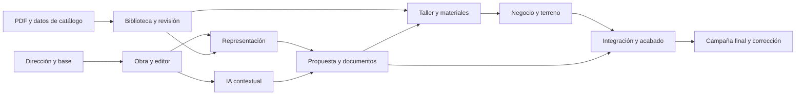

# Ejecución: calidad de producto y pruebas al final

[Volver al plan](README.md) · [Prompts](08-prompts.md)

## Estado y autorización

**Implementación autorizada: «ahora empieza», 17-10-2026.** Objetivo: v1 definitiva,
con IA como capacidad central capaz de completar el trabajo delegado y preparar
cambios de presentación de página/portal y PDF, con muestra, deshacer, límites por
rol/presupuesto y protecciones por consecuencia. [Estado de construcción](10-implementacion.md).

La implementación conserva los invariantes de motor/Decimal, RLS/org, revisiones
emitidas y consecuencias externas con clic humano. Son propiedades del producto,
no una obligación de interrumpir el trabajo para pedir permiso por cada cambio.

## Método recomendado

1. Un responsable integra la experiencia completa y toma decisiones coherentes.
2. Trabajar sobre una colección representativa de productos y tareas, con datos
   entendibles. Identificar qué es demo y qué tiene fuente real.
3. Construir recorridos completos: entrada, trabajo, resultado y recuperación.
   No terminar una fase con un botón bonito que lleva a la pantalla vieja.
4. Inspeccionar lo que se está diseñando en el navegador para decidir proporción,
   legibilidad e interacción. Eso forma parte de diseñar, sin campañas de QA por
   cada componente ni suites repetidas.
5. Anotar defectos y pendientes en un único registro breve. Reparar durante la
   construcción lo imprescindible para poder continuar; dejar la campaña general
   de bugs, regresión y aceptación al final.
6. Integrar y pulir el producto completo; después ejecutar la campaña final,
   corregir y repetir únicamente las comprobaciones afectadas.
7. Entregar por PR cuando esté revisable. No crear una cadena de PR con suites
   completas por cada pequeño ajuste ni debilitar CI para evitar el cierre final.

No hay aprobación intermedia obligatoria de cada lámina, pantalla o paquete.
Una preferencia nueva del dueño puede orientar el trabajo; no hace falta pararlo
por elecciones reversibles que el agente puede resolver con criterio.

## Qué no conviene repetir del proceso anterior

Un sistema puede pasar cientos de capturas y seguir siendo difícil de entender.
En esta ejecución la unidad de progreso es una tarea que se siente resuelta.
La documentación acompaña las decisiones duraderas; no debe competir con el
tiempo destinado a diseño, activos, interacción y resultado final.

No convertir cada ID de la auditoría en un test, cada pantalla en un reporte ni
cada crítica en un nuevo control visible. La mejor solución puede ser quitar
una decisión o cambiar el flujo.

## Secuencia de trabajo

| Paquete | Resultado concreto | Dependencia principal | Se considera construido cuando… |
|---|---|---|---|
| P01 · Dirección y base | Tema único, componentes y shell coherentes; autoridad de diseño reconciliada | Este estudio y ref actual | Hay una sola dirección funcionando en superficies representativas, sin dos sistemas de estilos nuevos. |
| P02 · Obra y biblioteca | Borrador inmediato, defaults, ventanas primero y selección por lote | P01 | Se puede empezar una obra y configurar varias ventanas sin repetir lo común. |
| P03 · Editor | Cotas, aperturas y propiedades directas; detalle progresivo | P02 | El recorrido de diseño ordinario se entiende sin navegar contratos internos. |
| P04 · Representación | Uniones, materiales, vistas y capturas compartidas | P03 + datos/activos representativos | Las ventanas elegidas se reconocen y las vistas usan el mismo producto. |
| P05 · Asistente | Una entrada contextual, acciones reversibles, preview útil para lotes | P02/P03 | Peticiones habituales producen resultados claros con poco trámite. |
| P06 · Lectura de catálogo | Pipeline PDF/layout/OCR/visión, relaciones y trabajo recuperable | Contratos actuales; corpus con derechos | Un PDF prepara un catálogo estructurado con evidencia y pendientes reales. |
| P07 · Biblioteca y revisión | Importar primero, revisar por excepción, activar y mantener versiones | P06 + P01/P04 | Un responsable resuelve dudas sobre la página y entiende capacidades disponibles. |
| P08 · Venta y documentos | Precio/comparación, propuesta/PDF/visor/portal excelentes | P02/P04/P05 | Una venta se presenta con calidad y sin reentrada ni alteración de emitidos. |
| P09 · Taller y materiales | BOM visual, documentos por estación, compras, stock y cola útil | P04/P07/P08 | Una orden se entiende por pieza/tarea y los faltantes se pueden preparar. |
| P10 · Resto del negocio | Clientes, cobros, campo, despacho, analítica y ajustes consistentes | P01/P02/P08/P09 | Las superficies restantes siguen el mismo criterio y el rol correcto. |
| P11 · Integración y acabado | Recorrido completo, estados, español, dispositivos y detalle fino | P01–P10 | No quedan transiciones a una experiencia vieja ni estados sin resolver. |
| P12 · Campaña final | Pruebas, uso profesional, corrección de bugs y cierre | P11 | Evidencia de tareas y checks finales, con límites reales declarados. |

La secuencia es una ruta de integración, no una prohibición de resolver antes una
dependencia. P06 puede adelantarse si el catálogo real es necesario para P04.
No completar cientos de sistemas antes de conseguir una experiencia excelente
con un conjunto representativo; tampoco dar por terminado el producto por ese
conjunto inicial.

## Dependencias que determinan la calidad

El mayor riesgo no es el color del botón: es intentar representar un sistema real
sin datos/activos, o vender importación integral con un pipeline que limita PDF
a 20 páginas y puede perder el gráfico de una página mixta. Esas dependencias
deben resolverse en la implementación, no maquillarse.

## Skills y herramientas: criterio, no una colección

Una skill aporta instrucciones reutilizables. No es una garantía de gusto ni
un diseñador adicional. Se usa si mejora el trabajo concreto y se adapta a la
intención del dueño. No hace falta instalar decenas ni cambiar todo el stack.

| Recurso | Cuándo aporta | Cómo usarlo en este programa |
|---|---|---|
| `apple-design` | Manipulación directa, continuidad, gesto, jerarquía, foco y materiales | Principios de interacción; evitar una imitación de macOS o exceso de blur. |
| `emil-design-eng` | Detalle, densidad, defaults, estados y calidad perceptiva | Revisión Before/After/Why; quitar fricción antes de añadir adornos. |
| `animate` | Una transición necesita propósito y comportamiento | Solo cuando se construya movimiento que ayuda a orientarse. |
| `animation-performance` | Movimiento que pierde fluidez | Intervenir si existe el problema; no optimizar hipotéticamente todo. |
| `mobile-native` | Terreno, portal y tareas táctiles web | Teclado, viewport, tap, safe areas y prueba real al final. |
| Skill local `testing-framedex` | Acceso al stack, roles, worker, IA y revisión local | Reutilizar estado del dueño; no reconstruir/sembrar sin necesidad. |
| Skill de navegador disponible | Inspección del producto y diseño en contexto | Usar el navegador real, capturas seleccionadas y tareas concretas. |
| Skill PDF | Composición y renderizado de documentos | Ver páginas reales, no solo HTML o extracción de texto. |
| `openai-docs` | Dudas de herramientas/skills o integración OpenAI | Consultar fuente oficial; no adivinar capacidades o precios. |

`prototype`, `pick-ui-library` o `break-ui` se invocan cuando el dueño o el trabajo
real lo requieran según sus reglas, no por acumulación. No crear un panel de
variantes de diseño dentro del producto ni un toggle de datos extremos en la
versión final. Una exploración documental puede ser útil sin convertirse en
otra función que mantener.

No se crean subagentes por defecto. Si se autorizan posteriormente, un integrador
mantiene lenguaje/flujo y divide superficies sin escritores simultáneos sobre
el mismo archivo. No se delega «diseña todo» a varias personas con criterios
contradictorios.

## Referencias de método consultadas

- [Skills · documentación de OpenAI](https://developers.openai.com/plugins/concepts/skills).
- [Divulgación progresiva · Nielsen Norman Group](https://www.nngroup.com/articles/progressive-disclosure/).
- [Reconocimiento en lugar de recuerdo · NN/g](https://www.nngroup.com/articles/recognition-and-recall/).
- [Heurísticas de usabilidad · NN/g](https://www.nngroup.com/articles/ten-usability-heuristics/).
- [Deshacer acciones automatizadas · Microsoft HAX](https://www.microsoft.com/en-us/haxtoolkit/pattern/g9-c-undo-automated-actions/).
- [WCAG](https://www.w3.org/TR/wcag/) y [contraste mínimo](https://www.w3.org/WAI/WCAG22/Understanding/contrast-minimum.html).

Estas fuentes apoyan decisiones; no convierten una regla genérica en un requisito
industrial ni sustituyen la observación de profesionales de ventanas.

## Objetivos de experiencia para medir al final

Son metas de diseño iniciales, no resultados actuales ni bloqueos automáticos de
cada paquete. La medición empieza con las tareas y condiciones registradas.

| Resultado | Objetivo orientativo | Cómo comprobarlo |
|---|---|---|
| Primera ventana estándar | Un profesional llega al primer precio disponible en ~2 minutos desde una obra nueva | Grabación de tarea sin instrucciones del autor. |
| Obra de cinco ventanas ordinarias | Preparar una propuesta en ~10 minutos con catálogo/precios ya disponibles | Contar tiempo y ayudas necesarias. |
| Cambio simple de ancho | Una edición de cota o un pedido IA, sin pasos técnicos extra | Número de interacciones y conservación del resto. |
| Decisiones repetidas | Serie/vidrio/acabado comunes se definen una vez | Obra con duplicados y excepciones. |
| Comprensión de producto | Apertura, vista y acabado reconocibles sin leer un enum | Identificación por usuarios y comparación con fuente. |
| IA | Menos esfuerzo que el camino manual para los pedidos elegidos | Comparar tarea completa, preguntas, correcciones, tiempo y Deshacer. |
| Catálogo PDF | Reducir sustancialmente el tiempo humano frente a transcripción manual | Medir extracción, revisión de dudas y corrección por tipo de documento. |
| Fuente técnica | Ningún valor industrial inventado aceptado como autoridad | Contraste de candidatos, motor y fuente. |
| PDF comercial | Cliente entiende producto, total, condiciones y siguiente paso | Lectura sin explicación del cotizador. |
| Taller | Operario localiza pieza/destino y ejecuta la tarea sin buscar en varios documentos | Uso con orden real controlada y papel/lector apropiados. |
| Respuesta | Selección inmediata; registrar latencia del motor y de IA separadamente | Medir en equipo/red definidos, sin inventar tiempos. |

La comparación competitiva cronometrada requiere cuentas, misma tarea y datos
equivalentes. Los vídeos no sirven como baseline de tiempo de un usuario nuevo.

## Campaña final única

### Escenarios de producto

| Escenario | Qué debe quedar demostrado |
|---|---|
| Empresa nueva | Entrada sin configuraciones irrelevantes, borrador y recuperación. |
| Casa sencilla | Cinco ventanas, defaults, duplicación, vidrio/color, precio y propuesta. |
| Obra grande | Buscar, virtualizar, agrupar, seleccionar y editar por lote sin perder contexto. |
| Geometría variada | Fijo, practicable, oscilobatiente, corredera, puerta y conjunto; familias avanzadas que se declaren. |
| Acabados | Blanco/madera/metal/bicolor; texturas y vistas consistentes en documentos. |
| Revisión comercial | Cambio de propuesta emitida, diferencias y sucesor inmutable. |
| IA | Cambio simple, lote, ambigüedad, incompatibilidad, fallo de proveedor, reanudar y deshacer. |
| Catálogo | Nativo/escaneado/mixto, tablas multipágina, conflictos, faltantes y actualización de versión. |
| Producción | Preparar/lote, corte, material, etiqueta, armado, calidad, remake y salida. |
| Compras/stock | Faltante, variantes, recepción parcial/daño, reserva y retazo. |
| Terreno/portal | Uso móvil, teclado, sin red si está soportado, evidencia y sincronización. |
| Roles/seguridad | Costos privados, org equivocada, revisión obsoleta, permisos y consecuencias externas. |
| Documentos | Página real sin corte/solapado, B/N, total/alcance, QR y formato de etiqueta. |

### Comprobaciones de ingeniería al cierre

Ejecutar checks apropiados y la suite completa porque el rediseño será transversal:
lint, typecheck, tests, build y gate de base de datos con el entorno correcto.
Cambios de fórmula requieren golden-case y revisión; no regenerar goldens para
hacer pasar la salida visual. Si se modifican fórmulas, incluir el drill de
mutaciones correspondiente. Repetir solo lo afectado al corregir fallos.

Los contratos API se cambian en backend y se regeneran OpenAPI/orval; no editar
generados a mano. Tampoco retirar guardas de Decimal/RLS por incomodidad visual.
Las reglas de estilo que contradigan la nueva autoridad de diseño se actualizan
de forma explícita, conservando los controles funcionales/de seguridad.

### Cierre real

Recibo corto con ref, tareas observadas, evidencia necesaria, resultados de
checks y límites. Declarar conexiones no probadas. Si falta un servicio o una
máquina, no simular una aceptación real. Completar todos los arreglos posibles y
dejar un pendiente concreto; no reabrir infinitamente el mismo circuito de tests.

## Decisiones aún abiertas, con ruta de resolución

| Duda | Cómo se resuelve sin paralizar el trabajo |
|---|---|
| Qué sistemas/proveedores reales priorizar | Usar los documentos autorizados disponibles y las necesidades del dueño; empezar por pocos representativos. |
| Activos reales de textura/sección | Inventariar fuente/derechos; diferenciar muestra, sección exacta y representación. |
| Parser/OCR y costo operativo | Elegir con corpus representativo y medición final; arquitectura con etapas intercambiables. |
| Cobertura de máquinas y formatos | Usar capacidades declaradas y equipo real; no deducir de una pantalla de CNC. |
| Adecuación a distintos tamaños de empresa | Entrada sencilla, profundidad por rol y tarea; evitar preferencias para cada pequeño desacuerdo. |

Ninguna de estas dudas exige al dueño responder un formulario antes de empezar
el trabajo de diseño autorizado. Si una fuente o acceso es imprescindible para
una parte concreta, se avanza con las demás y se pide solo ese dato.
