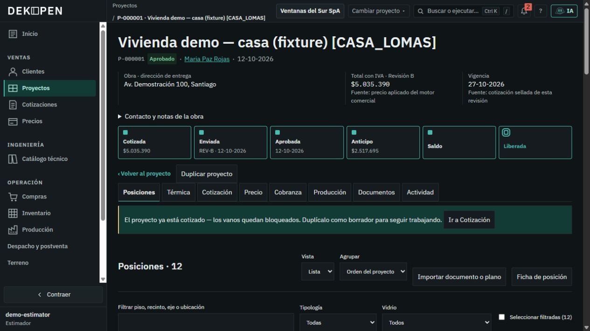
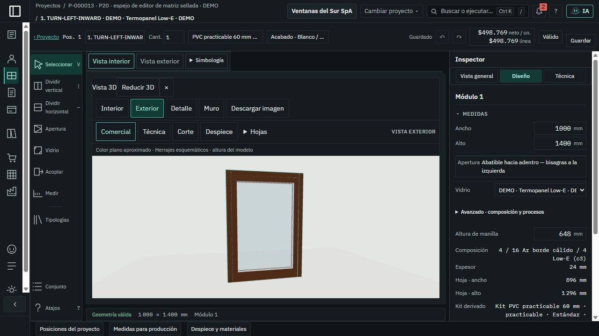
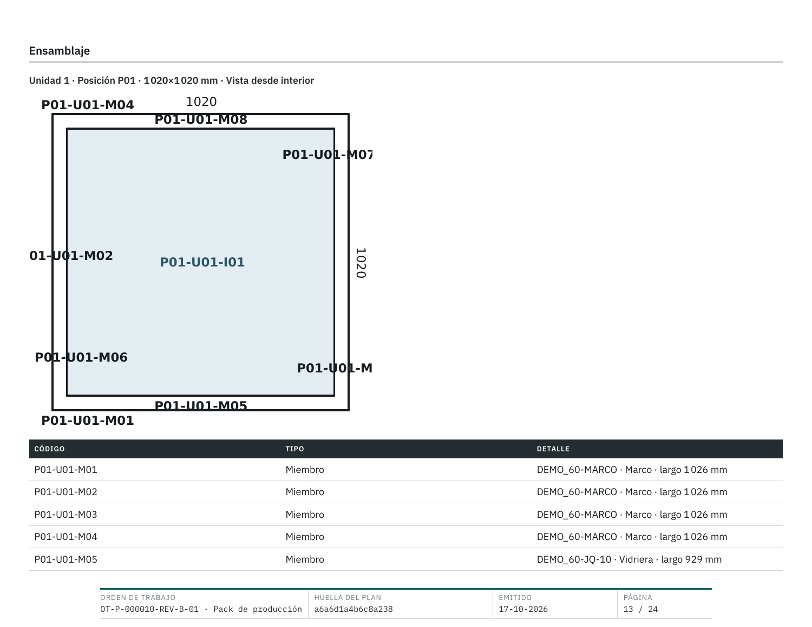

# Evidencia seleccionada · auditoría UX 17-10-2026

[Volver al plan](../README.md)

Capturas propias del producto y páginas renderizadas de documentos del fixture.
Se conservan doce imágenes de la auditoría inicial, seis de la primera
implementación y nueve de la segunda reconstrucción. Cada etapa conserva su
procedencia; no se convierte toda la exploración temporal en evidencia versionada.

## Procedencia y autoridad de la auditoría inicial

- Navegador: stack REVIEW reutilizado en `127.0.0.1:5179`, roles de estimación y
  encargado de taller. Viewports de escritorio de aproximadamente 1 280 × 720.
- **El SHA del build que sirven los contenedores no se verificó.** Las capturas
  muestran el producto de esa sesión; el código se inspeccionó por separado en
  `edcfd2844d2c2fc7cbb0d3b543b50e9089ab9b3f`.
- Datos DEMO/sintéticos; no acreditan fabricación ni operación de una empresa real.
- PDF comercial: artefacto existente `casa-DOC-01-REV-B.pdf`, página 2 de 8.
- PDF de taller: renderizados on-demand de un plan existente, en lectura
  autenticada/RLS sin escrituras. No se emitió una revisión ni orden nueva.
- Se preservaron sesiones, stack, bases y los diseños originales. La propuesta IA
  de ancho se descartó; su job/historial de consulta puede permanecer registrado.
- Se evaluaron ambos temas y se restauró el tema oscuro inicial. Estas imágenes
  documentan el estado previo, no la apariencia propuesta.
- `manifest.json` registra archivo, origen temporal, bytes y SHA-256. Las imágenes
  se copiaron sin editar; la extensión se ajustó a JPEG/PNG según los bytes
  devueltos por la captura, sin recomprimir. Los originales permanecen en
  `.run/ux-audit-2026-10-17/` en esta estación.

## Índice

| Imagen | Qué permite revisar |
|---|---|
| [proyecto.jpg](proyecto.jpg) | Cabecera, fases y pestañas que preceden a las ventanas. |
| [editor-2d.jpg](editor-2d.jpg) | Lienzo, herramientas, cotas e inspector. |
| [editor-3d.jpg](editor-3d.jpg) | Nogal plano observado, encuadre y capas de controles. |
| [ia-cambio-simple.jpg](ia-cambio-simple.jpg) | Propuesta correcta de ancho y carga de ceremonia/advertencias. |
| [catalogo-importador.jpg](catalogo-importador.jpg) | Plantilla primero y controles de archivo redundantes. |
| [produccion.jpg](produccion.jpg) | Concentración de OT y tarjetas sin referencia visual fuerte. |
| [compras.jpg](compras.jpg) | Jerarquía de necesidades, lenguaje y materiales con compra cero. |
| [inventario.jpg](inventario.jpg) | Filas de apariencia idéntica; no demuestra duplicación de registros. |
| [hoy.jpg](hoy.jpg) | Tareas repetidas por causa/obra en el punto de entrada. |
| [pdf-comercial.png](pdf-comercial.png) | Resumen legible sin miniaturas y aprovechamiento de página. |
| [pdf-corte.png](pdf-corte.png) | Información de corte útil que debe conservarse. |
| [pdf-ensamblaje.png](pdf-ensamblaje.png) | Códigos cortados y solapados en plano de ensamblaje. |

Las fuentes de competencia se citan mediante enlaces y tramos de vídeo en
[la investigación](../02-competencia.md). No se redistribuyen vídeos ni catálogos
de terceros. No se incluyen PDF completos con acceso al portal, tokens, credenciales
o archivos de sesión. No se hicieron pruebas responsive nuevas en esta auditoría.

## Ejemplos que sostienen el diagnóstico

### El objeto queda detrás de controles

### La textura seleccionada no se reconoce como madera

### El plano pierde legibilidad en los códigos de pieza

## Implementación autorizada · 17-10-2026

Las capturas siguientes pertenecen a la construcción de `codex/v1-experiencia`,
desde `edcfd2844d2c2fc7cbb0d3b543b50e9089ab9b3f`. REVIEW se reconstruyó desde
este checkout sin ejecutar fixture/reset. Se seleccionaron imágenes de builds
sucesivos de la integración final; las anteriores no se atribuyen al build nuevo.
El [registro](../10-implementacion.md) separa código, ejercicios reales y límites.

Los datos son sintéticos. La IA se ejercitó como estimador; el importador se
inspeccionó como jefe de taller. Se restauró la sesión de estimación. El PDF
privado de `P-000016` se preparó y revisó sin emitir ni enviar. La captura del
importador muestra la entrada y sus permisos; no acredita la conversión completa
de un catálogo de fabricante. Las texturas 3D son ilustrativas.

| Captura | Qué permite revisar |
|---|---|
| [Editor 2D](implementacion/editor-2d.jpg) | Lienzo, uniones, cotas, precio indicativo e inspector progresivo. |
| [Exterior 3D](implementacion/editor-3d.jpg) | Vista exterior Nogal con ingletes; representación ilustrativa. |
| [Muestra IA](implementacion/ia-propuesta.jpg) | Precio del motor y continuidad hacia la preparación del PDF. |
| [PDF integrado](implementacion/pdf-revision.jpg) | Página 2 del PDF real, dibujo mayor, destinatario e importe; sin emisión. |
| [Materiales](implementacion/materiales.jpg) | Relación entre dibujo y materiales en una ficha amplia. |
| [Catálogo desde PDF](implementacion/catalogo-pdf.jpg) | PDF primero y plantilla secundaria con rol autorizado. |

[Manifiesto de implementación](implementacion/manifest.json): formato, dimensiones
de imagen, bytes y SHA-256. Los archivos son JPEG devueltos por CUA; solo se corrigió
la extensión, sin editar ni recomprimir. Las dimensiones del archivo no acreditan
por sí mismas una matriz de dispositivos. No se incluyen QR de acceso, PDFs
completos con capacidades, credenciales, mensajes de acceso ni sesiones.

## Segunda reconstrucción · 17-10-2026

Estas imágenes documentan la dirección que sustituye la primera apariencia
rechazada por el dueño. El [registro vigente](../11-reconstruccion.md) conserva
P13–P20, investigación, implementación, pruebas y límites. Código de cierre:
`dca9454bd7989f57a3f1b001bf1920b3f83a0a8d`, en
[PR #159](https://github.com/KaraAliOsman/framedex/pull/159).

REVIEW se reconstruyó desde el checkout, sin fixture/reset ni pérdida de sesiones.
Las capturas se seleccionaron de builds sucesivos; no todas corresponden al
último build. La página principal de IA, el editor 2D y la biblioteca móvil sí se
capturaron después de reconstruir con el último ajuste. Biblioteca a 1.024 px
precede al ajuste de recorte del contenedor, sin cambios posteriores en su
composición. El manifiesto distingue
estos estados y no inventa un SHA embebido por captura.

| Captura | Qué permite revisar |
|---|---|
| [Asistente](reconstruccion/ia-principal.jpg) | Conversación principal, historial y encargos reconocibles. |
| [IA para una ventana](reconstruccion/ia-alcance.jpg) | Precio real del motor y conservación del diseño guardado, sin emitir o enviar. |
| [Biblioteca móvil](reconstruccion/biblioteca-mobile.jpg) | Cabecera, medidas y acción de creación a 390×844. |
| [Biblioteca a 1.024 px](reconstruccion/biblioteca-1024.jpg) | Selección y decisiones heredadas en un espacio más estrecho. |
| [Catálogo](reconstruccion/catalogo.jpg) | Ilustración de familia como ayuda de reconocimiento y sección declarada separada. |
| [Editor 2D](reconstruccion/editor-2d.jpg) | Dibujo, herramientas e inspector de la segunda dirección. |
| [Exterior 3D](reconstruccion/editor-3d.jpg) | Encuentros y acabado Nogal ilustrativo. |
| [Portada PDF](reconstruccion/pdf-portada.png) | Presentación Editorial v2 con preferencias de marca selladas. |
| [Resumen PDF](reconstruccion/pdf-resumen.png) | Resumen comercial y aceptación en la misma página. |

[Manifiesto de reconstrucción](reconstruccion/manifest.json): origen local,
fecha, formato, dimensiones, bytes y SHA-256. Las imágenes se copiaron sin editar
ni recomprimir. Los PDF son previews de datos sintéticos existentes, renderizados
con Poppler; no se emitió una revisión nueva. No se incluyen PDF completos con
capacidades, QR de acceso, credenciales ni sesiones. Las fotos privadas se
ejercitaron con muestras sintéticas restauradas mediante eventos de auditoría.

La revisión visual incluyó 1.440×900, 1.280×800, 1.024×768 y 390×844; estas nueve
imágenes no representan una matriz exhaustiva ni una medición de aprendizaje.
Proline y Aluminios 2000 no se adjuntaron: ninguna imagen acredita su importación.
